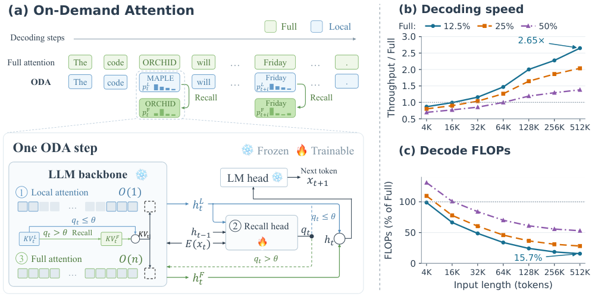
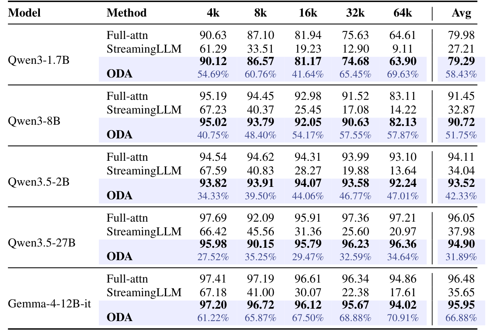

# On-Demand Attention

**Language Models Know When to Recall**

[**arXiv:2609.20734**](https://arxiv.org/abs/2609.20734) | [English](README.md) | [简体中文](README_zh.md)

On-Demand Attention（ODA）先执行 Local 注意力，再由轻量级召回头决定是否用 Full 注意力重新计算当前步。只训练召回头，冻结语言模型参数，完整的历史 KV 缓存始终保留，供后续解码按需访问。

[](https://arxiv.org/html/2609.20734v2#S1.F1)

*论文图 1：ODA 解码流程与执行效率。效率部分采用固定续写和预设 Full 调用率。*

## 实验结果

[](https://arxiv.org/html/2609.20734v2#S3.T1)

*论文表 1：RULER 完整结果。ODA 得分下方为 Full 调用率；Avg 分别对五种长度的得分和调用率取平均。*

[实验设置与复现状态](RESULTS.md)。

## 快速开始

本仓库提供 **Router 训练、Transformers 推理、评测，以及 Qwen3/Qwen3.5 的实验性 vLLM 实现**。Gemma 使用 Transformers，具体模型和运行限制见[支持列表](docs/usage.md#supported-implementations)。推理和评测的 batch、训练时每卡的 microbatch 默认均为 **1**。

训练好的 Router 权重将单独发布到 **Hugging Face**。发布前，请使用自行训练导出的权重。

```bash
git clone https://github.com/Fenghaibo-git/On-Demand-Attention.git
cd On-Demand-Attention
export PYTHONPATH="$PWD/src:$PWD/scripts${PYTHONPATH:+:$PYTHONPATH}"
```

按[环境说明](ENVIRONMENTS.md)安装依赖后，指定本地基座模型和训练得到的 Router 权重，即可使用 Transformers 推理：

```bash
python scripts/generate.py --backend hf \
  --model /path/to/models/Qwen3.5-2B \
  --router /path/to/trainable_state.pt \
  --prompt "请解释注意力机制的工作原理。" --max-new-tokens 256
```

[训练](docs/reproduction.md#train-and-audit) · [vLLM 推理](docs/usage.md#inference) · [评测](docs/usage.md#evaluation) · [RULER16K 流程](docs/reproduction.md#merge-and-ruler16k)

## 许可证

采用 [GPL-3.0](LICENSE)，保留上游代码的版权和许可证声明，详见 [NOTICE](NOTICE)。
